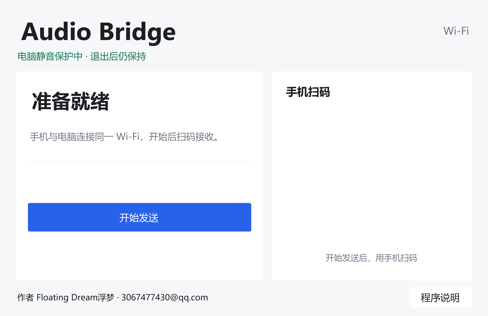
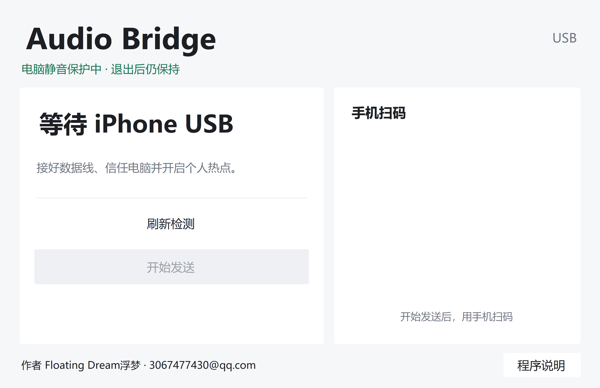

# Audio Bridge 音频桥

把 Windows 正在播放的声音送到 iPhone，再由手机播放到已连接的人工耳蜗、助听器或耳机。

Send Windows playback audio to an iPhone, then listen through a cochlear implant processor, hearing aid or headphones already connected to the phone.

**免费公开源码，仅限非商业用途。当前为公开预览版。**

**Free source-available software for noncommercial use. This is a public preview.**

作者 / Author：**Floating Dream浮梦**  
联系邮箱 / Contact：[3067477430@qq.com](mailto:3067477430@qq.com)

## 项目用途 / Purpose

当 Windows 与用户现有听力设备尚不能顺畅直连时，本程序可通过 iPhone 中转，作为过渡或补充方案。作者当前体验良好，希望给听障用户多一种使用已有设备听到电脑声音的选择；效果因设备与环境而异。

When Windows cannot stream directly and conveniently to an existing hearing device, this iPhone relay offers a transitional or supplementary option. The author reports a good current experience and hopes to offer another accessible listening option using existing devices. Results vary by device and environment.

部分 Windows 11 电脑与兼容 LE Audio 的听力设备已经支持直连；“有蓝牙”并不代表协议兼容。已有稳定官方直连方案时，可优先使用。[微软官方说明 / Microsoft guidance](https://support.microsoft.com/en-us/accessibility/windows/using-hearing-devices-with-your-windows-11-pc)

Some Windows 11 PCs already stream directly to compatible LE Audio hearing devices. Bluetooth support alone does not establish protocol compatibility. Prefer a working official direct connection when available; see the Microsoft guidance linked above.

## 下载哪个文件 / Which file to download

点击本仓库页面右侧的 **Releases**，下载需要的文件：

Open **Releases** on this repository page and select the required file:

| 文件 / File | 用途 / Purpose |
| --- | --- |
| **AB-WiFi.zip** | Wi-Fi 无线版，电脑与手机连接同一 Wi-Fi。 / Wi-Fi edition; PC and phone share a Wi-Fi network. |
| **AB-USB.zip** | USB 有线版，需数据线、信任电脑、苹果驱动及开启个人热点。 / USB edition; requires a data cable, trust, Apple drivers and Personal Hotspot enabled. |
| **AB-Source.zip** | 完整双版源码、对应第三方源码、补丁和许可。 / Complete source for both editions, corresponding third-party source, patches and licenses. |
| **Guide.pdf** | 中英双语高清图文说明。 / Illustrated bilingual guide. |
| **Guide-ZH.docx / Guide-EN.docx** | 中文及英文可编辑说明书。 / Editable Chinese and English guides. |
| **SHA256SUMS.txt** | 下载文件完整性校验值。 / File integrity checksums. |

请下载上表的程序包。GitHub 自动生成的 **Source code (zip)** 只包含网页仓库文件；在当前发布方式下，它不包含完整程序或完整开发源码。完整源码请下载 **AB-Source.zip**。当前 Code 页面提供介绍、许可和说明书，开发源码通过 Release 提供下载。

Download the app archives listed above. GitHub's automatic **Source code (zip)** contains only this web repository's files; with this publication method, it is not the app or the complete developer source. Download **AB-Source.zip** for complete source. The current Code page holds project information, licensing and the guide; developer source is distributed through the Release.

## 开始使用 / Getting started

1. 解压程序包，打开 `AudioBridge.exe`（Wi-Fi）或 `AudioBridgeUsb.exe`（USB）。建议使用 `C:\AudioBridge\WiFi` 或 `C:\AudioBridge\USB` 等短目录；正常使用无需再解压包内的 `Source.zip`、`ThirdParty.zip`。  
   Extract the app archive and open `AudioBridge.exe` for Wi-Fi or `AudioBridgeUsb.exe` for USB. Use a short folder such as `C:\AudioBridge\WiFi` or `C:\AudioBridge\USB`. Normal use does not require extracting the nested `Source.zip` or `ThirdParty.zip`.
2. 电脑点“开始发送”，首次如出现 Windows 授权提示请自行确认；手机扫码，用支持实时音频及后台播放的本地浏览器打开。  
   Click Start sending on the PC and approve Windows yourself if prompted. Scan the QR code and open it in a phone browser supporting real-time audio and background playback.
3. 手机点“开始接收”，正常播放电脑音频。音量在手机调节；电脑点“停止发送”或手机点“停止接收”即可停止。  
   Tap Start receiving on the phone and play PC audio normally. Adjust volume on the phone. Stop with Stop sending on the PC or Stop receiving on the phone.

USB 建议使用 iPhone 官方原装数据线。第三方线可能因品质、规格或仅支持充电而不稳定或无法识别，必须支持数据传输。USB 版仍需个人热点建立本地 USB 网络；其他电脑软件可能借此使用手机流量。

For USB, prefer an original Apple data cable. Third-party cables may be unreliable or unrecognized because of quality, specifications or charging-only design; data transfer support is required. Personal Hotspot is still needed to establish the local USB network. Other PC applications might use mobile data through it.

## 锁屏使用 / Playback while locked

**Wi-Fi 和 USB 均支持锁屏继续播放，锁屏不会主动停止传输。正常连接时无需保持屏幕亮起。需要停止时，在电脑或手机手动停止。** 来电、断线或系统结束浏览器等情况仍可能中断，不承诺仅手动停止才会断开。

**Both Wi-Fi and USB support playback while the phone is locked. Locking does not actively stop transmission, and the screen need not stay on during a normal connection. Stop manually on the PC or phone when finished.** Calls, disconnections or operating-system browser termination can still interrupt audio; manual stopping is not the only possible interruption.

## 延迟和听感 / Delay and listening experience

作者当前环境下的自述体验：**USB 约 50 ms，Wi-Fi 约 60 ms；USB 听感可能略好**，可按连接便利性及听音偏好选择。这些是体验估计，不是仪器测量的完整端到端延迟或全设备承诺。两版采用相同编码策略，不能据此认定 USB 必然音质更好。

The author's environment-specific estimates are **about 50 ms for USB and 60 ms for Wi-Fi, with possibly slightly better perceived USB sound**. Choose by convenience and listening preference. These are self-reported estimates, not instrumented end-to-end measurements or guarantees for all devices. Both editions use the same codec strategy, so these impressions do not establish inherently higher USB fidelity.

## 隐私与兼容性 / Privacy and compatibility

程序内部采集电脑声音，不请求麦克风、不保存录音、不上传音频到云端。电脑输出静音并设为零音量，退出后仍保持；需要外放时先停止私人内容，再手动恢复系统音量。二维码和接收链接是会话凭据，请勿公开；这些设计不代表绝对保密。

The app captures PC playback internally, without requesting the microphone, recording audio or uploading it to the cloud. PC output is muted and set to zero, and remains so after exit. Stop private playback before manually restoring speakers. Treat QR codes and receiver links as session credentials and do not share them. These measures do not guarantee absolute confidentiality.

当前目标平台为 Windows 11 x64。iPhone 必须已能向所用听力设备播放声音。本版通过 iPhone 中转，不是 Windows 人工耳蜗蓝牙驱动。构建、接收逻辑、桌面浏览器回环和内置PDF检查已完成；这不代表所有 iPhone/iOS/浏览器、耳蜗、助听器及锁屏组合均已实测。程序当前未签名，不要求关闭杀毒软件或防火墙。

The target platform is Windows 11 x64. The iPhone must already play audio to the listening device. This is an iPhone relay, not a Windows cochlear-implant Bluetooth driver. Build, receiver logic, desktop browser loopback and embedded PDF checks have been completed; this does not establish testing of every iPhone/iOS/browser, hearing device or lock-screen combination. The current executables are unsigned. Disabling antivirus or the firewall is not required.

## 真实界面 / Actual interface

图片是实际原生控件的高清导出。USB 图记录等待连接状态；它不是连接成功或听音测试证明。说明书里的接收页图来自实际桌面浏览器按手机宽度显示，不是 iPhone 实机照片。

The images are high-resolution exports of actual native controls. The USB image shows a waiting state, not evidence of successful connection or listening tests. Receiver figures in the guide are actual desktop browser captures at phone width, not iPhone photographs.

[查看中英双语说明书 / View the bilingual guide](Guide.pdf)

## 许可与作者 / License and author

本版有权授权的原创部分采用自定义 **Audio Bridge 非商业源码许可 1.0**，允许个人无障碍听音、非商业学习研究及无偿公益协助，禁止收费分发、商业捆绑等商业化。个人上班听音例外详见 [LICENSE](LICENSE)。第三方许可和此前有效 MIT 权利继续有效，不能追溯撤回。这是源码公开项目，不是 OSI 定义的开源项目。自定义许可未经执业律师审查。

Original material that the licensors have authority to license is offered under the custom **Audio Bridge Noncommercial Source License 1.0**. Personal accessibility listening, noncommercial learning/research and unpaid charitable assistance are permitted; commercialization such as paid distribution and commercial bundling is prohibited. See [LICENSE](LICENSE) for the personal workplace-listening exception. Third-party licenses and valid prior MIT grants remain effective and cannot be retroactively revoked. This is source-available, not OSI-defined open source. The custom license has not been reviewed by a practicing lawyer.

本项目在 AI 编程工具辅助下开发，与 Apple、Cochlear 或其他厂商无隶属或背书关系，不提供医疗诊断、治疗或人工耳蜗临床参数配置。详情见 [LEGAL_NOTES.md](LEGAL_NOTES.md)。

The project was developed with AI coding assistance. It is not affiliated with or endorsed by Apple, Cochlear or other manufacturers and does not provide diagnosis, treatment or clinical cochlear-implant configuration. See [LEGAL_NOTES.md](LEGAL_NOTES.md).

欢迎在 Issues 反馈版本、系统、连接方式、浏览器和问题复现步骤；不需要病史或其他健康资料。请遮住二维码、链接及个人信息；安全问题可私下发至作者邮箱。

Please report the app version, operating systems, connection method, browser and reproduction steps in Issues. Medical history and other health information are unnecessary. Hide QR codes, links and personal details. Security issues may be reported privately to the author's email.

**Floating Dream浮梦 · 3067477430@qq.com**
